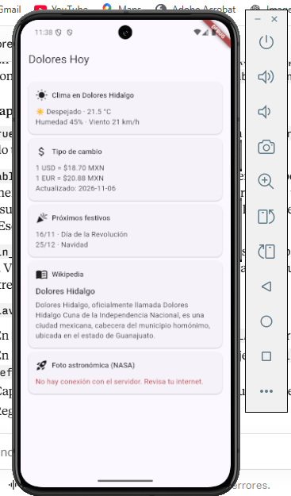
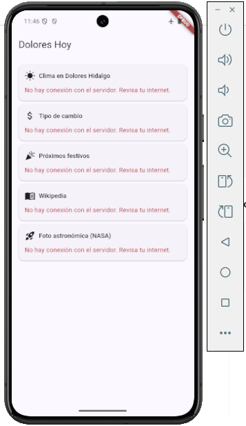
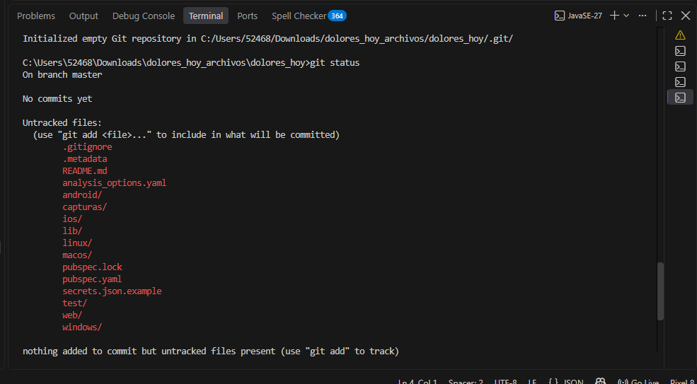
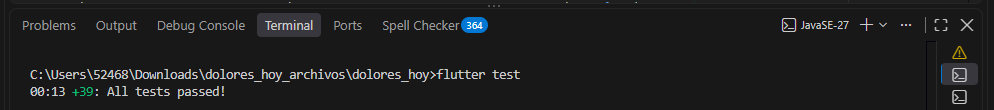

# Dolores Hoy

Tablero móvil hecho en **Flutter** que consume **5 APIs gratuitas** aplicando **TDD** y buenas prácticas de seguridad.

> Desarrollo Móvil Integral · UTNG
> Profesor: Anastacio Rodríguez García
> Alumno: _Ramires Lopez Maria Yazmin_

## ¿Qué hace?

Muestra en una sola pantalla información de Dolores Hidalgo, Guanajuato:

| Tarjeta | API | ¿Requiere clave? |
|---|---|---|
| Clima actual | [Open-Meteo](https://open-meteo.com) | No |
| Tipo de cambio MXN → USD / EUR | [Frankfurter](https://frankfurter.dev) | No |
| Próximos días festivos de México | [Nager.Date](https://date.nager.at) | No |
| Resumen de Wikipedia | [Wikipedia ES](https://es.wikipedia.org/api/rest_v1/) | No |
| Foto astronómica del día | [NASA APOD](https://api.nasa.gov) | **Sí** |

## Capturas

| Tablero con las 5 APIs | Sin internet |
|---|---|
|  |  |

| Clave NASA inválida (solo falla una tarjeta) |
|---|
|  |

## Arquitectura

```
lib/
  dominio/        excepciones.dart, modelos.dart
  datos/          cliente_seguro.dart, config_claves.dart, servicios.dart
  presentacion/   tablero_viewmodel.dart, pantalla_tablero.dart
  main.dart
test/             ayudas.dart + 4 archivos de pruebas
```



- **ClienteSeguro**: única puerta de salida a internet para las 5 APIs.
- **Un servicio por API**: `ServicioClima`, `ServicioCambio`, `ServicioFestivos`, `ServicioWikipedia`, `ServicioNasa`.
- **TableroViewModel**: cada API tiene su propio estado; si una falla, las otras cuatro siguen funcionando (se cargan en paralelo con `Future.wait`).

## Seguridad aplicada

- HTTPS obligatorio (se rechaza `http://` antes de enviar nada).
- Timeout de 8 segundos y límite de 1 MB por respuesta.
- Validación de JSON recibido y de los tipos de datos.
- Validación de entradas (coordenadas, año, texto del tema) y construcción de URLs con `Uri.https` / `pathSegments` (evita *path injection*).
- Validación de salidas: URLs de imagen solo `https` y `media_type` de la NASA.
- Clave de la NASA fuera del código, con `--dart-define-from-file`; `secrets.json` está en `.gitignore`.
- `ConfigClaves.toString()` y `ClienteSeguro.redactar()` evitan filtrar claves en logs.
- Errores inesperados muestran un mensaje genérico al usuario.


## Cómo ejecutarlo

Requisitos: Flutter 3.x, un emulador o dispositivo Android.

```bash
git clone <URL_DE_TU_REPOSITORIO>
cd dolores_hoy

# Crea tu archivo de claves a partir de la plantilla
copy secrets.json.example secrets.json      # Windows
# cp secrets.json.example secrets.json      # macOS / Linux

flutter pub get
flutter run --dart-define-from-file=secrets.json
```

`secrets.json` trae `DEMO_KEY` (límite bajo de peticiones). Para usar tu propia clave, regístrala gratis en <https://api.nasa.gov> y reemplázala en `secrets.json`.

## Pruebas (TDD)

Las pruebas no usan internet: simulan las respuestas con `MockClient`.

```bash
flutter test
```



## Notas

- Si una API cambia su formato, la tarjeta correspondiente muestra "El servidor respondió con datos que no entiendo" y hay que actualizar el modelo y su prueba.
- La clave que va dentro de la app no es realmente secreta; para claves de pago se recomienda un servidor proxy.


